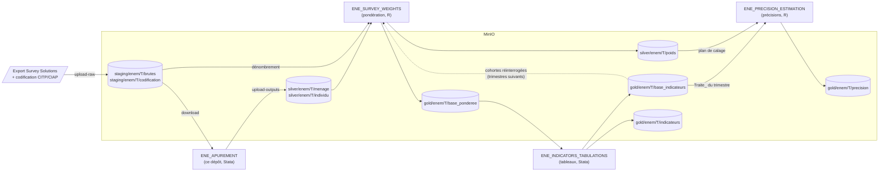
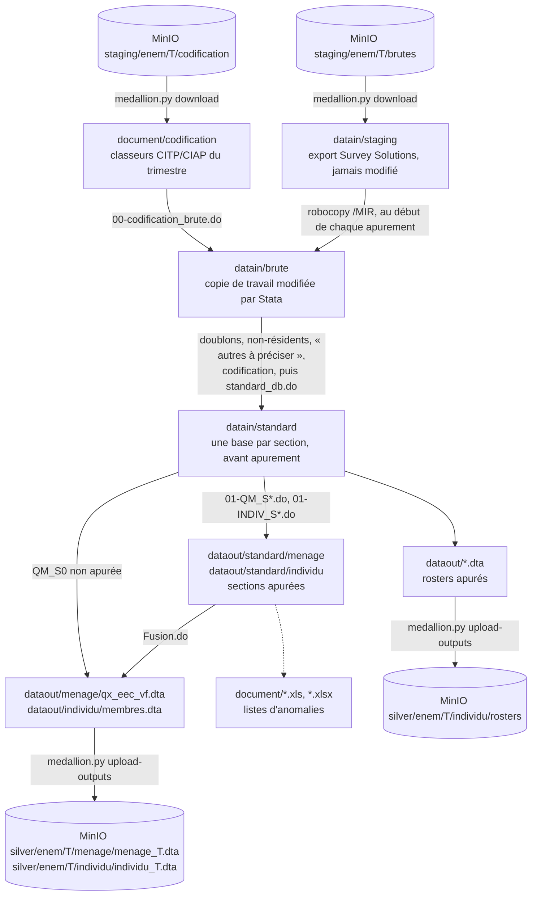
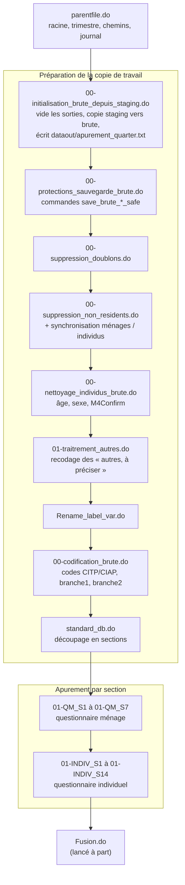

# Apurement trimestriel ENEM

Ce dépôt contient le code Stata qui transforme l'export Survey Solutions de
l'Enquête Nationale sur l'Emploi, volet ménage (ENEM), en bases contrôlées et
corrigées : une base ménage, une base individu et cinq rosters. Ces bases sont
les entrées de la pondération.

Le document explique comment :

- refaire l'apurement d'un trimestre sur n'importe quel poste, à partir du dépôt
  git et d'un accès à MinIO ;
- garder une copie intacte de l'export Survey Solutions ;
- contrôler les sorties avant la fusion et avant la publication ;
- diagnostiquer les erreurs fréquentes.

La pondération, la tabulation et le calcul des précisions sont faits dans
d'autres dépôts (voir [Place dans la chaîne ENE](#place-dans-la-chaîne-ene)).

> **État au 26 octobre 2026.** Le T1 2026 est apuré et publié. Les anomalies
> relevées dans le rapport d'apurement du T1 2026 (FP3, P20, EP8, SE, TP7, RHE)
> sont corrigées depuis le commit `21bb934` ; voir
> [Historique](#historique-des-corrections).

## Sommaire

- [Démarrage rapide](#démarrage-rapide)
- [Place dans la chaîne ENE](#place-dans-la-chaîne-ene)
- [Flux des données](#flux-des-données)
- [Ordre d'exécution](#ordre-dexécution)
- [Répertoires locaux](#répertoires-locaux)
- [Prérequis](#prérequis)
- [Contrat de données](#contrat-de-données)
- [Procédure pour un trimestre](#procédure-pour-un-trimestre)
- [Contrat de sortie avant fusion](#contrat-de-sortie-avant-fusion)
- [Points de vigilance](#points-de-vigilance)
- [Protections intégrées](#protections-intégrées)
- [Historique des corrections](#historique-des-corrections)
- [Dépannage](#dépannage)

## Démarrage rapide

Depuis la racine du dépôt, avec le fichier `.env` en place (voir
[Variables d'environnement](#variables-denvironnement)) :

```powershell
$env:ENE_QUARTER = "T1_2026"
$env:STATA_EXE   = "C:\chemin\vers\StataMP-64.exe"

python scripts\medallion\medallion.py download --dry-run   # 1. entrées MinIO (essai à blanc)
python scripts\medallion\medallion.py download --overwrite
python tools\run_apurement.py check                         # 2. contrôles statiques
python tools\run_apurement.py apurement                     # 3. apurement (environ 3 min)
python tools\run_apurement.py fusion                        # 4. fusion
python scripts\medallion\medallion.py upload-outputs --dry-run
python scripts\medallion\medallion.py upload-outputs --overwrite   # 5. publication dans silver
```

Chaque étape est détaillée dans [Procédure pour un trimestre](#procédure-pour-un-trimestre).

## Place dans la chaîne ENE

Les quatre dépôts de la chaîne ne s'échangent jamais de fichiers directement :
tout passe par MinIO. Les scripts d'échange sont ceux de
`ENE_MEDALLION_ORCHESTRATION`, qui contient aussi le contrat de données de
chaque dépôt.



Conséquence pratique : une correction de l'apurement ne touche les indicateurs
qu'après la relance de toute la chaîne en aval : pondération, tabulation, puis
précisions. Les poids ne changent que si la liste des ménages ou des individus
change ; une correction de valeurs laisse les poids identiques.

## Flux des données

L'export original n'est jamais modifié. Stata travaille sur une copie,
recréée à chaque lancement.



## Ordre d'exécution

`program/apurement.do` enchaîne les étapes ci-dessous ; `program/Fusion.do` se
lance à part, après contrôle des sorties. `program/parentfile.do` est toujours
exécuté en premier : il fixe la racine, le trimestre, les chemins et ouvre le
journal.



Les sections non apurées pour le T1 2026 sont QM_S0 (identification), qui entre
telle quelle dans la base ménage, et INDIV_S15 (disponibilité), absente des
bases finales. QM_S5 (émigration) est apurée mais reste au niveau émigré : elle
n'entre pas dans la base individu.

Ne pas utiliser les anciens orchestrateurs (`program/pipeline_master.do`,
`program/archive/Fusion_ENE.do`), restés dans le dossier OneDrive du T1 2026 hors
dépôt.

## Répertoires locaux

| Répertoire | Rôle | Règle d'utilisation |
| --- | --- | --- |
| `datain/staging` | Export Survey Solutions original | Téléchargé depuis MinIO ; ne jamais modifier |
| `datain/brute` | Copie de travail Stata | Recréée depuis `staging` à chaque lancement |
| `datain/standard` | Une base par section, avant apurement (`standard_db.do`) | Recréé à chaque lancement |
| `dataout/standard/menage`, `dataout/standard/individu` | Sections apurées | À contrôler avant la fusion |
| `dataout/menage`, `dataout/individu` | Bases fusionnées | Sorties publiées |
| `dataout/*.dta` | Rosters apurés | Sorties publiées (sauf `Revenu_es.dta`) |
| `dataout/apurement_quarter.txt` | Trimestre traité | Contrôlé avant la publication |
| `document` | Listes d'anomalies (Excel) | À examiner pendant l'apurement |
| `document/codification` | Classeurs CITP/CIAP du trimestre | Téléchargés depuis MinIO |
| `datatemp` | Journal robocopy, marqueurs, journaux du lanceur (`batch/`) | Utile pour diagnostiquer |
| `logs` | Journaux de session Stata (`.log`, `.ansi`) | Un fichier horodaté par lancement |
| `program` | Do-files Stata | Code métier |
| `scripts/medallion` | Lanceur MinIO `medallion.py` | Échanges avec MinIO |
| `tools` | Lanceur Stata, contrôles statiques, utilitaires Python | |

Les dossiers de données sont ignorés par git. Le fichier `.ansi` du journal
garde les couleurs des erreurs (lisible dans un terminal ANSI ou dans VS Code).

## Prérequis

### Logiciels

- Windows avec `cmd.exe` et `robocopy.exe` (copie `staging` vers `brute`) ;
- Stata 17 ou plus ;
- Python 3.10 ou plus, avec `boto3`, `botocore` (MinIO), `pandas`, `openpyxl`
  et `xlrd` (contrôle des classeurs de codification) ;
- le dépôt `ENE_MEDALLION_ORCHESTRATION` cloné à côté de ce dépôt ;
- une connexion internet au premier lancement si la commande Stata `violin`
  n'est pas installée (l'initialisation lance alors `ssc install violin`).

### Variables d'environnement

| Variable | Utilisée par | Rôle |
| --- | --- | --- |
| `ENE_QUARTER` | Stata, lanceurs | Trimestre traité, forme `T<n>_<année>` (ex. `T1_2026`) ; défaut `T1_2026` |
| `ENE_BASE_DIR` | Stata | Racine du dépôt (par défaut : répertoire courant, racine ou `program/`) |
| `ENE_MENAGE_EXPORT` | Stata, contrat | Nom de l'export ménage s'il ne suit pas `ENEM_<TX><ANNEE>.dta` (T1_2026 donne `ENEM_T12026.dta`) |
| `STATA_EXE` | `tools/run_apurement.py` | Chemin de l'exécutable Stata |
| `ENE_ORCHESTRATION_ROOT` | `medallion.py` | Dépôt d'orchestration ; par défaut `../ENE_MEDALLION_ORCHESTRATION` |
| `MINIO_ENDPOINT`, `MINIO_ACCESS_KEY`, `MINIO_SECRET_KEY` | scripts MinIO | Accès MinIO |
| `ENE_CREDENTIALS_FILE`, `ENE_SECRETS_DIR` | scripts MinIO | Fichier d'identifiants à la place des variables |

`medallion.py` lit aussi les fichiers `.env` du répertoire courant, de ce dépôt
et du dépôt d'orchestration, sans écraser une variable déjà définie. Le `.env`
est ignoré par git ; ne jamais écrire d'identifiant dans le code ni dans la
documentation. Exemple :

```text
MINIO_ENDPOINT=http://<serveur-minio>:9000
MINIO_ACCESS_KEY=...
MINIO_SECRET_KEY=...
ENE_QUARTER=T1_2026
STATA_EXE=C:\chemin\vers\StataMP-64.exe
```

## Contrat de données

Source : `ENE_MEDALLION_ORCHESTRATION/ene_medallion_io/apurement_contract.py`,
utilisé par `scripts/medallion/medallion.py` (via `launcher.py`).

### Entrées (`medallion.py download`)

| Fichier local | MinIO | Statut |
| --- | --- | --- |
| `datain/staging/ENEM_<TX><ANNEE>.dta` | `staging/enem/<T>/brutes/ENEM_<TX><ANNEE>.dta` | obligatoire (export ménage ; nom réglable par `ENE_MENAGE_EXPORT`) |
| `datain/staging/membres.dta` | `staging/enem/<T>/brutes/membres.dta` | obligatoire |
| `datain/staging/r_activite_s.dta`, `emigration.dta`, `r_revenu_h_emp.dta`, `r_competence_quali.dta`, `Activiteparent.dta`, `Revenu.dta`, `Revenu_es.dta` | `staging/enem/<T>/brutes/<fichier>` | obligatoires (lus par les do-files) |
| `datain/staging/assignment__actions.dta`, `couts_biens.dta`, `disponibilite.dta`, `interview__*.dta`, `VISITE_IND.dta`, `VISITE_ROOSTER.dta` | `staging/enem/<T>/brutes/<fichier>` | facultatifs (non lus ; gardés pour un export complet) |
| `document/codification/*` | `staging/enem/<T>/codification/` | obligatoire (dossier non vide) |

Le préfixe `staging/enem/<T>/brutes/` contient aussi le dénombrement
(`denombrement/`, `denombrement_update/`), qui appartient à la pondération :
l'export est donc listé fichier par fichier, jamais téléchargé en entier.

Les noms des classeurs de codification attendus par `00-codification_brute.do`
et `tools/validate_codification_inputs.py` sont propres au trimestre (ex.
`codification_emploi_principal_T1_2026_cp.xlsx`, `Activite_secondaire_T126.xlsx`).
Un même nom de classeur peut exister en plusieurs versions : vérifier que
`document/codification/` contient bien celle qui doit servir (voir
[Points de vigilance](#points-de-vigilance)).

### Produits publiés (`medallion.py upload-outputs`)

Liste explicite ; rien d'autre n'est publié.

| Fichier local | MinIO |
| --- | --- |
| `dataout/menage/qx_eec_vf.dta` | `silver/enem/<T>/menage/menage_<T>.dta` |
| `dataout/individu/membres.dta` | `silver/enem/<T>/individu/individu_<T>.dta` |
| `dataout/Activiteparent.dta`, `r_activite_s.dta`, `r_competence_quali.dta`, `r_revenu_h_emp.dta`, `Revenu.dta` | `silver/enem/<T>/individu/rosters/<fichier>` |
| `document/*.xls`, `document/*.xlsx` (avec `--with-quality-reports`) | `silver/enem/<T>/quality_reports/apurement_errors/` |

Avant tout envoi, le script vérifie que les sept produits existent et ne sont
pas vides, et que `dataout/apurement_quarter.txt` indique le trimestre demandé.
Un manifeste (fichiers envoyés, commit git du code) est écrit dans
`silver/enem/<T>/_manifests/`. Commiter le code avant de publier, pour que ce
commit désigne bien le code qui a produit les bases.

Pour le T1 2026, MinIO contient aussi des objets d'une ancienne convention, hors
contrat et lus par aucun script : `silver/enem/T1_2026/individu/membres.dta`,
`silver/enem/T1_2026/menage/qx_eec_vf.dta`, `silver/enem/T1_2026/*/standard/`
et `bronze/enem/T1_2026/`. Ils ont été remplacés par les versions corrigées le
26 octobre 2026.

### Entrées publiées par l'apurement (`medallion.py upload-raw`)

L'apurement est propriétaire de l'export Survey Solutions et des classeurs de
codification de son trimestre. `upload-raw` publie les fichiers du tableau des
entrées présents dans `datain/staging/` et `document/codification/` ; les
objets déjà présents sur MinIO sont conservés sauf avec `--overwrite`.

## Procédure pour un trimestre

### Sur un poste neuf

```powershell
git clone <url>/ENE_APUREMENT.git
git clone <url>/ENE_MEDALLION_ORCHESTRATION.git
python -m pip install boto3 pandas openpyxl xlrd
cd ENE_APUREMENT
# créer .env (voir plus haut), puis :
$env:ENE_QUARTER = "T1_2026"
```

### Étape 1. Télécharger les entrées

```powershell
python scripts\medallion\medallion.py download --dry-run
python scripts\medallion\medallion.py download --overwrite
```

L'essai à blanc liste ce qui serait téléchargé et les entrées obligatoires
absentes de MinIO (code de retour 1 dans ce cas). Si l'export n'est pas sur
MinIO, le copier dans `datain/staging/` puis le publier avec `upload-raw`
(voir [Préparer un nouveau trimestre](#préparer-un-nouveau-trimestre)).

### Étape 2. Lancer les contrôles statiques

```powershell
python tools\run_apurement.py check
```

Résultat attendu :

```text
Stata raw-save guard validation: OK
Stata conditional Excel-export guard validation: OK
Codification input validation: OK
```

### Étape 3. Lancer l'apurement

```powershell
python tools\run_apurement.py config      # vérifie la racine, le trimestre et les chemins
python tools\run_apurement.py apurement
```

Sous Windows, le lanceur ouvre Stata en mode interactif, fenêtre réduite, et
non en mode batch (`/e`) : en batch, Stata ignore `shell`, donc la copie
`datain/staging` vers `datain/brute` (robocopy) ne se fait pas et
l'initialisation s'arrête en `r(603)`. Stata se ferme seul à la fin ; le code
retour est écrit dans `datatemp/batch/run_<étape>.rc` et le journal du lanceur
dans `datatemp/batch/run_<étape>.log`. Le journal de session est dans `logs/`.

Lancement manuel dans Stata, après `cd` vers la racine du dépôt (ou ouverture du
projet `ENE_2026T1.stpr`, dont les chemins sont relatifs) :

```stata
do "program/parentfile.do"
do "$dofiles/apurement.do"
```

### Étape 4. Examiner les listes d'anomalies

Les do-files exportent les anomalies dans `document/`. Certaines demandent une
correction métier (souvent dans `01-traitrement_autres.do`) avant de continuer.

### Étape 5. Contrôler les sorties par section

Vérifier la présence des fichiers listés dans le
[Contrat de sortie avant fusion](#contrat-de-sortie-avant-fusion).

### Étape 6. Lancer la fusion

```powershell
python tools\run_apurement.py fusion
```

Ne pas enchaîner la fusion si l'apurement a échoué : elle tournerait sur des
sorties incomplètes.

### Étape 7. Publier

```powershell
python scripts\medallion\medallion.py upload-outputs --dry-run
python scripts\medallion\medallion.py upload-outputs --overwrite
```

Toujours lancer d'abord `--dry-run`. `--skip-quarter-check` permet de publier
des sorties produites avant l'existence du marqueur de trimestre (uniquement si
elles sont bien celles du trimestre demandé).

Après une republication, relancer la chaîne en aval : pondération
(`ENE_SURVEY_WEIGHTS`), tabulation (`ENE_INDICATORS_TABULATIONS`, y compris
`upload-bases`, car `Traite_` sert de cohorte aux trimestres suivants) et
précisions (`ENE_PRECISION_ESTIMATION`).

### Préparer un nouveau trimestre

1. Copier l'export Survey Solutions original et les classeurs de codification
   dans `datain/staging/` et `document/codification/`, puis les publier :

   ```powershell
   python scripts\medallion\medallion.py upload-raw --quarter T2_2026 --dry-run
   python scripts\medallion\medallion.py upload-raw --quarter T2_2026
   ```

   Ne jamais placer l'unique copie des données dans `datain/brute` : les
   do-files modifient ce répertoire.
2. Fixer `ENE_QUARTER` (et `ENE_MENAGE_EXPORT` si l'export ménage ne s'appelle
   pas `ENEM_<TX><ANNEE>.dta`). Garder `QX_EEC_VF.dta` comme nom de la copie de
   travail ménage (`brute_menage_work` dans `parentfile.do`).
3. Adapter les règles propres au trimestre, sur une branche dédiée : liste des
   entretiens doublons (`00-suppression_doublons.do`), noms des classeurs de
   codification (`00-codification_brute.do`,
   `tools/validate_codification_inputs.py`), bornes d'années (ex. `> 2026`) et
   sections fusionnées (`Fusion.do`). L'état du code d'un trimestre clos est
   conservé sur une branche d'archive (ex. `archive/2025T4`).
4. Suivre la procédure ci-dessus.

Pour reconstruire la copie de travail hors Stata :

```powershell
python tools\prepare_apurement_working_copy.py --reset-working-copy
```

## Contrat de sortie avant fusion

`program/Fusion.do` vérifie la présence des 20 fichiers suivants dans
`dataout/standard` et s'arrête si l'un manque.

| Ménage (`menage/`) | Individu (`individu/`) |
| --- | --- |
| `QM_S1_composition_menage.dta` | `INDIV_S1_autres_formes_travail.dta` |
| `QM_S2_education_formation.dta` | `INDIV_S2_situation_emploi.dta` |
| `QM_S3_formation_professionnelle.dta` | `INDIV_S3_emploi_principal.dta` |
| `QM_S4_immigration.dta` | `INDIV_S4_competences_qualifications.dta` |
| `QM_S6_difficultes_fonctionnelles.dta` | `INDIV_S5_pluriactivite.dta` |
| `QM_S7_logement.dta` | `INDIV_S6_emploi_secondaire.dta` |
| | `INDIV_S7_temps_travail.dta` |
| | `INDIV_S8_emploi_inadequat.dta` |
| | `INDIV_S9_recherche_emploi.dta` |
| | `INDIV_S10_recherche_emploi_disponibilite.dta` |
| | `INDIV_S11_chomage.dta` |
| | `INDIV_S12_emploi_anterieur.dta` |
| | `INDIV_S13_revenu_hors_emploi.dta` |
| | `INDIV_S14_activite_parents.dta` |

### Bases finales

| Fichier | Contenu | Clé |
| --- | --- | --- |
| `dataout/menage/qx_eec_vf.dta` | QM_S0 (non apurée) fusionnée avec QM_S7 | `interview__key` |
| `dataout/individu/membres.dta` | QM_S1, puis QM_S2, S3, S4, S6 et INDIV_S1 à S14 (`merge 1:1`, individus de QM_S1 seulement) | `interview__key`, `membres__id` |

Quand une variable figure dans plusieurs sections, la fusion garde la valeur de
la première section fusionnée (`merge` sans `update`). Une section qui corrige
une variable d'une autre section doit donc écrire la correction dans la base de
la section qui en est propriétaire (voir [Points de vigilance](#points-de-vigilance)).

### Rosters

Plusieurs lignes par individu : ils restent des bases séparées.

| Fichier | Section | Contenu | Clé |
| --- | --- | --- | --- |
| `Activiteparent.dta` | S14 | Parents (père, mère, tuteur) | `interview__key`, `membres__id`, `Activiteparent__id` |
| `r_activite_s.dta` | S5 | Activités de la pluriactivité | `interview__key`, `membres__id`, `r_activite_s__id` |
| `r_competence_quali.dta` | S4 | Compétences et qualifications | `interview__key`, `membres__id`, `r_competence_quali__id` |
| `r_revenu_h_emp.dta` | S13 | Revenus hors emploi | `interview__key`, `membres__id`, `r_revenu_h_emp__id` |
| `Revenu.dta` | S3 | Revenus de l'emploi principal | `interview__key`, `membres__id`, `Revenu__id` |

`Revenu_es.dta` (revenus de l'emploi secondaire) n'est pas publié.

## Points de vigilance

- **Variables d'une section corrigées dans une autre.** S3 recode SE1 à SE9
  (personnes reclassées hors emploi) puis supprime ces variables : depuis
  octobre 2026, elle reporte d'abord la correction dans
  `dataout/standard/individu/INDIV_S2_situation_emploi.dta`, d'où la fusion et
  la tabulation lisent SE. S14 reporte de même TP7 dans sa base individuelle.
  Toute nouvelle correction de ce type doit suivre ce modèle.
- **Sections qui écrasent leur entrée.** S3 et S6 sauvegardent dans
  `datain/standard` la base qu'elles lisent. Une relance isolée de ces sections
  ne repart donc pas de la même base : relancer l'apurement complet.
- **Sources apurées et non apurées.** Plusieurs sections lisent des variables
  d'autres sections dans `datain/standard` (non apurées) : WKI3 (S9), C2 (S12 et
  S13), l'âge de QM_S1 (S4 et S6).
- **Version des classeurs de codification.** Un classeur peut exister en
  plusieurs versions sous le même nom. Au T1 2026, une version plus ancienne de
  `Codif_activite_principales_T126.xlsx` changeait 22 codes CIAP (et les
  médianes de WKT1 calculées par branche). La version de référence est celle
  commitée dans `document/codification/`.
- **Reproductibilité.** Deux lancements complets sur le même export et la même
  codification donnent des bases identiques (vérifié le 26 octobre 2026).

## Protections intégrées

### Copie miroir `staging` vers `brute`

`program/00-initialisation_brute_depuis_staging.cmd` utilise `robocopy /MIR`.
Journal : `datatemp/robocopy_staging_to_brute.log`. L'initialisation vide aussi
`datain/standard` et `dataout`, pour ne jamais publier un mélange de résultats
anciens et nouveaux si l'apurement s'interrompt.

### Sauvegardes brutes contrôlées

`program/00-protections_sauvegarde_brute.do` définit trois commandes :

| Commande | Destination | Contrôle principal |
| --- | --- | --- |
| `save_brute_membres_safe` | `datain/brute/membres.dta` | Refuse un roster d'activité chargé par erreur |
| `save_brute_r_activite_s_safe` | `datain/brute/r_activite_s.dta` | Vérifie les variables propres au roster |
| `save_brute_menage_work_safe` | `datain/brute/QX_EEC_VF.dta` | Refuse une base individuelle chargée par erreur |

### Exports Excel conditionnels

Un export filtré doit être précédé d'un comptage :

```stata
count if <condition>
if r(N) > 0 {
    export excel ... if <condition>, firstrow(variables) replace
}
```

## Historique des corrections

| Date | Commit | Correction |
| --- | --- | --- |
| Mai-juin 2026 | | Codification CIAP de l'emploi principal (`Codif_activite_principales_T126.xlsx`) ; `branche1` et `branche2` générées dans `00-codification_brute.do` |
| Mai-juin 2026 | | S14 : roster parental (`dataout/Activiteparent.dta`) séparé de la section individuelle |
| Mai-juin 2026 | | S6 : filtres d'éligibilité et variables `ES*` revus |
| Mai-juin 2026 | | `00-suppression_non_residents.do` synchronise ménages et individus avant les sections |
| 24 oct. 2026 | `c599fa9` et précédents | Dépôt indépendant du poste : `parentfile.do`, lanceurs Python, contrat de données MinIO |
| 26 oct. 2026 | `21bb934` | `01-traitrement_autres.do` : retrait de `FP3=168` et `P20=2` appliqués à toute la population ; S3 : EP8 « VINGT CINQ MILLE » = 25 000 et report des SE dans S2 ; S13 : RHE `.a` → 0 limité aux répondants ; S14 : report de TP7 ; `Fusion.do` : base ménage = QM_S0 + QM_S7 |
| 26 oct. 2026 | `405a610` | Codification CIAP : version du 18 juin |
| 26 oct. 2026 | `b0dc647` | `run_apurement.py` : Stata en mode interactif sous Windows |

Au T1 2026, les corrections du 26 octobre ont fait sortir 37 personnes de
l'emploi dans la tabulation (taux d'emploi 65,16 % → 65,02 %), sans changer les
poids. Le détail est dans le rapport d'apurement du trimestre (chapitre 7).

## Dépannage

| Erreur | Cause probable | Vérification ou action |
| --- | --- | --- |
| `r(601)` au démarrage | `datain/staging/membres.dta` absent | Télécharger l'export dans `datain/staging` |
| `r(603)` à l'initialisation | Copie robocopy non faite : Stata en mode batch (`/e`), fichier verrouillé ou erreur robocopy | Lancer par `tools/run_apurement.py` ; lire `datatemp/robocopy_staging_to_brute.log` ; fermer Excel |
| `command Q is unrecognized` | `/q` passé à Stata depuis Git Bash, qui le transforme en `Q:/` | Lancer par `tools/run_apurement.py` ou depuis PowerShell |
| `r(198)` sur `export excel` | Filtre sans observation | Ajouter `count if ...` |
| `r(199)` `violin` unrecognized | Dépendance Stata absente | `ssc install violin` |
| `r(601)` dans `Fusion.do` | Section absente | Vérifier que la section a tourné dans `apurement.do` |
| Codes CIAP ou médianes WKT1 différents d'un passage à l'autre | Autre version d'un classeur de codification | Comparer `document/codification/` à la version commitée |
| `ENE_MEDALLION_ORCHESTRATION introuvable` | Dépôt d'orchestration absent | Le cloner à côté de ce dépôt ou définir `ENE_ORCHESTRATION_ROOT` |
| `Racine du dépôt ENE_APUREMENT introuvable` | Stata lancé hors du dépôt | `cd` vers la racine (ou `program/`), ou définir `ENE_BASE_DIR` |
| `Refus : dataout/apurement_quarter.txt indique ...` | Sorties d'un autre trimestre dans `dataout/` | Relancer l'apurement avec le bon `ENE_QUARTER` |
| `skip existing` lors d'une publication | Objet déjà présent sur MinIO | Ajouter `--overwrite` (après `--dry-run`) |
