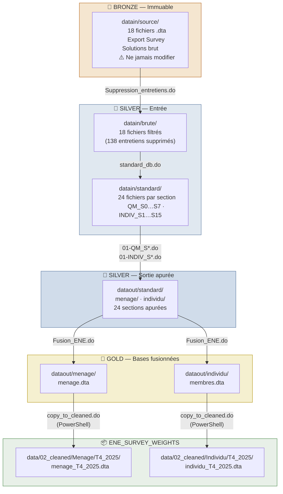
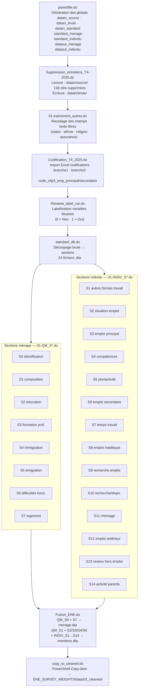
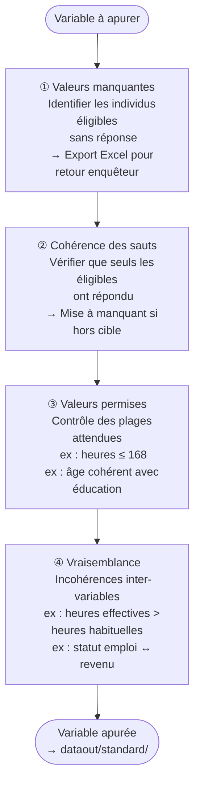
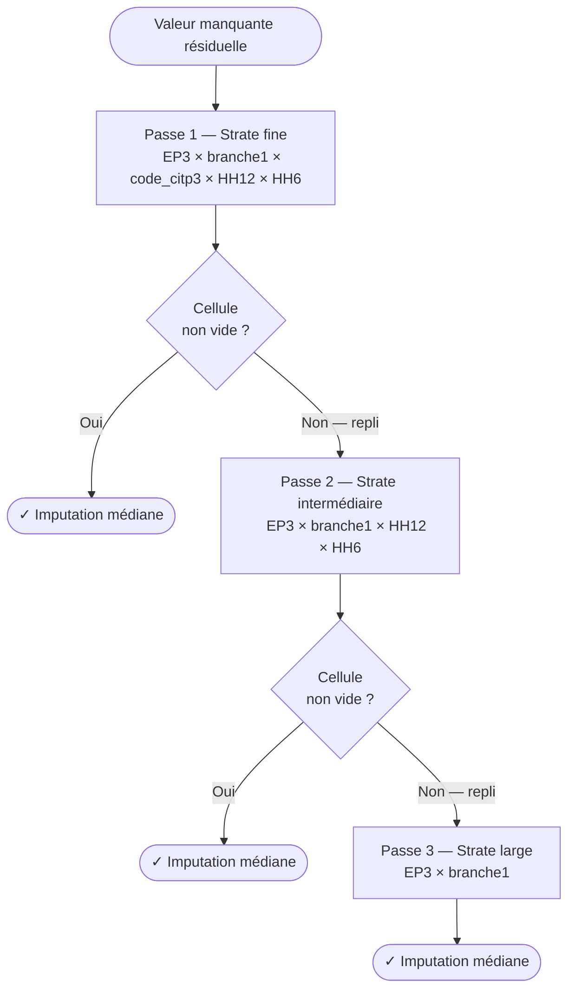

# Pipeline d'Apurement — ENEM Ménages T4 2025

**Institut National de la Statistique — Côte d'Ivoire**  
Enquête Nationale sur l'Emploi auprès des Ménages  
Documentation technique · Version 1.1 · Avril 2026  
Outil : Stata 17 · Collecte : Survey Solutions · Contrôle de version : Git

---

## Table des matières

1. [Vue d'ensemble](#1-vue-densemble)
2. [Architecture médaillon](#2-architecture-médaillon)
3. [Séquence d'exécution](#3-séquence-dexécution)
4. [Flux de données détaillé](#4-flux-de-données-détaillé)
5. [Méthodologie d'apurement par variable](#5-méthodologie-dapurement-par-variable)
6. [Imputation par médiane stratifiée](#6-imputation-par-médiane-stratifiée)
7. [Gestion de la qualité](#7-gestion-de-la-qualité)
8. [Variables construites](#8-variables-construites)
9. [Points d'attention pour la prochaine vague](#9-points-dattention-pour-la-prochaine-vague)

---

## 1. Vue d'ensemble

Le pipeline d'apurement de l'ENEM-Ménages T4 2025 couvre la **Phase 5 du GSBPM** (traitement statistique). Il s'insère dans une chaîne de production en quatre projets distincts :

---

## 2. Architecture médaillon

Le projet suit une **architecture médaillon Bronze / Silver / Gold** garantissant l'immuabilité des données brutes et la reproductibilité complète du pipeline.

---

## 3. Séquence d'exécution

Le point d'entrée est `parentfile.do` qui déclare tous les globals, puis appelle les scripts dans l'ordre suivant :

---

## 4. Flux de données détaillé

Chaque fichier produit par Survey Solutions traverse l'ensemble des couches :

```mermaid
flowchart LR
    subgraph SS["Survey Solutions"]
        EXP["Export .dta
        QX_EEC_VF · membres
        Revenu · Activiteparent
        VISITE_IND · etc.
        (18 fichiers)"]
    end

    subgraph SRC["datain/source/"]
        S1F["QX_EEC_VF.dta"]
        S2F["membres.dta"]
        S3F["Revenu.dta"]
        SDOT["... (15 autres)"]
    end

    subgraph BRU["datain/brute/"]
        B1F["QX_EEC_VF.dta
        − 138 entretiens"]
        B2F["membres.dta
        − lignes associées"]
        BDOT["... (15 autres)"]
    end

    subgraph STD["datain/standard/"]
        T1["QM_S0_identification"]
        T2["QM_S1_composition_menage"]
        T3["INDIV_S2_situation_emploi"]
        TDOT["... (21 autres)"]
    end

    subgraph OUT["dataout/"]
        MF["menage/menage.dta
        (ménage × logement)"]
        IF["individu/membres.dta
        (individu × 14 sections)"]
    end

    EXP -->|"copie manuelle"| SRC
    SRC -->|"Suppression_entretiens.do
    merge m:1 keep(master)"| BRU
    BRU -->|"standard_db.do"| STD
    STD -->|"01-QM_S*.do
    01-INDIV_S*.do
    apurement + recodage"| OUT
```

---

## 5. Méthodologie d'apurement par variable

Chaque variable est traitée selon une séquence standard en quatre étapes :

---

## 6. Imputation par médiane stratifiée

Pour les variables continues à valeurs manquantes résiduelles (heures WKT, loyer L6), une imputation par **médiane stratifiée** est appliquée en trois passes successives, du plus fin au plus grossier :

| Variable | Signification |
|---|---|
| `EP3` | Statut dans l'emploi (salarié, indépendant, patron…) |
| `branche1` | Branche CIAP agrégée (Agriculture / Industrie / Commerce / Autre service) |
| `code_citp3` | Code CITP-08 à 3 positions (groupe de base) |
| `HH12` | Région administrative |
| `HH6` | Milieu de résidence (1 = Urbain, 2 = Rural) |

---

## 7. Gestion de la qualité

### Entretiens supprimés

| Motif | Nombre | Critère |
|---|---|---|
| Entretiens problématiques | 6 | Identifiés manuellement |
| Entretiens vides | 131 | `HH14 == .` |
| Entretien en surnombre | 1 | Excédent selon région/ZD `69-78-22-41` |
| **Total** | **138** | |

### Traçabilité des erreurs

Chaque problème est exporté dans un fichier Excel explicitement nommé dans `document/` **avant** correction (ex : `E_WKT1_0.xlsx`, `SRH4_Manquants.xlsx`, `Erreur_L6_coh.xls`). Cela permet de justifier chaque décision et de retracer les anomalies jusqu'à l'enquêteur responsable.

---

## 8. Variables construites

| Variable | Description |
|---|---|
| `EN_EMP` | Statut d'emploi agrégé (1 = en emploi, 0 = hors emploi) |
| `branche1` | Branche CIAP agrégée, 4 modalités |
| `branche2` | Secteur économique, 3 modalités (Primaire / Secondaire / Tertiaire) |
| `code_citp3_emp_principal` | Code CITP-08 emploi principal, 3 positions |
| `code_citp3_emp_secondaire` | Code CITP-08 emploi secondaire, 3 positions |
| `code_citp3_pluriactivite1–4` | Codes CITP-08 autres emplois, 3 positions |
| `NB_HEURE_TRAVAIL_TOTAL` | Heures totales travaillées toutes activités confondues |

---

## 9. Points d'attention pour la prochaine vague

> **Résolu en T4 2025** — les points ~~barrés~~ ont été corrigés dans cette vague.

1. ~~**Interface avec la pondération manuelle**~~ — `copy_to_cleaned.do` automatise le transfert vers `ENE_SURVEY_WEIGHTS` via PowerShell (contourne les locks OneDrive).

2. ~~**Bronze inviolable**~~ — `datain/source/` est désormais la couche Bronze immuable. `Suppression_entretiens.do` lit depuis `source/` et écrit dans `brute/` sans jamais modifier la source.

3. **Fichiers volumineux** — `01-traitrement_autres.do` (562 Ko) et `Codification_T4_2025.do` (542 Ko) contiennent des centaines de `replace` manuels. Une approche par table de correspondance Excel réduirait la maintenance lors des prochaines vagues.

4. **`01-INDIV_S15_disponibilite.do`** — fichier stub, à implémenter ou à retirer définitivement.

5. **`assignment__actions.dta`** — ne contient pas de variable `interview__key`. La boucle de suppression détecte ce cas via `cap confirm variable` et copie le fichier tel quel.

---

*Document généré depuis l'inspection du code source — Avril 2026*  
*Pipeline : `parentfile.do` → `Suppression_entretiens.do` → `apurement.do` → 26 do-files → `Fusion_ENE.do` → `copy_to_cleaned.do`*
